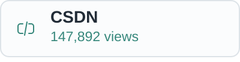

# Hi, I'm L_Z_J.

Currently focused on **Matter** · Embedded / C / Rust

`🌱 2004-04-21` · I'm grateful to live in an open-source world.

### Links

  <a href="https://www.mcoi.top"><picture><source media="(prefers-color-scheme: dark)" srcset="assets/links/blog-dark.svg"></picture></a>
  <a href="https://blog.csdn.net/L_Z_J_I?type=blog"><picture><source media="(prefers-color-scheme: dark)" srcset="assets/links/csdn-dark.svg"></picture></a>
  <a href="https://github.com/LZJ-I"><picture><source media="(prefers-color-scheme: dark)" srcset="assets/links/github-dark.svg"></picture></a>
  <a href="mailto:liu_zhen_jie@126.com"><picture><source media="(prefers-color-scheme: dark)" srcset="assets/links/email-dark.svg"></picture></a>
  <a href="https://space.bilibili.com/417496839"><picture><source media="(prefers-color-scheme: dark)" srcset="assets/links/bilibili-dark.svg"></picture></a>
  <a href="https://leetcode.cn/u/LZJ_I/"><picture><source media="(prefers-color-scheme: dark)" srcset="assets/links/leetcode-dark.svg"></picture></a>

